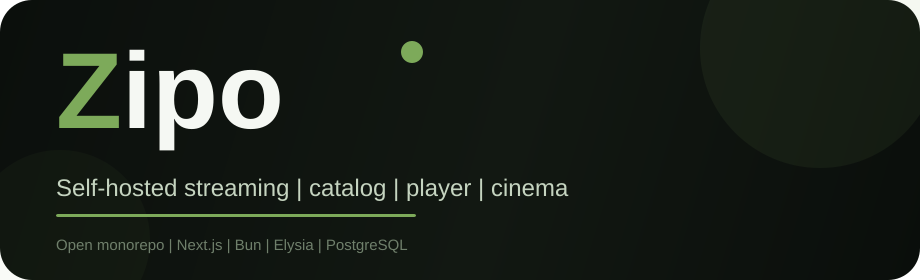

<p align="center">
  
</p>

<p align="center">
  <strong>English</strong>
  ·
  <a href="docs/i18n/README.pt-BR.md">Português (Brasil)</a>
  ·
  <a href="docs/i18n/README.zh-CN.md">简体中文</a>
</p>

<p align="center">
  <a href="LICENSE"></a>
  <a href="docs/SETUP.md"></a>
  
  
</p>

# ZiPo

**ZiPo** is a self-hosted streaming platform monorepo: rich catalog, authentication and profiles, a modern player, clips, synchronized cinema rooms, optional Pix “lifetime supporter” payments, and first-party media delivery when you own or license the content. A public TypeScript SDK and a drop-in login web component ship beside the apps.

Use only media you own, are licensed to stream, or that each provider’s terms allow. Secrets and authorization stay on the server — never in the browser.

## What is ZiPo?

ZiPo gives you a full stack to run a Netflix-style discovery experience on infrastructure you control:

- **Catalog first** — movies, series, and anime metadata federated from public sources (TMDB and more), with progressive enrichment.
- **Accounts & profiles** — Better Auth sessions, multi-profile UX, watch history and playlists.
- **Player** — native HLS-focused playback path, optional sandboxed embeds as operator-configured fallbacks, Anime4K flags, dual-site main/NSFW modes.
- **Social watch** — Cinema rooms with chat/presence and synchronized playback when a native stream is ready.
- **Clips & media jobs** — optional FFmpeg worker and Stream Bridge for prepared segments you are allowed to process.
- **SDK** — `@zipo/api-client` and `<zipo-auth>` for embedding login and catalog search outside the main site.

## Features

- Next.js 15 web app with next-intl (multi-locale UI)
- Bun + Elysia API, Drizzle + PostgreSQL, authenticated Redis, private MinIO/S3
- Feature-flagged V2 search/playback, protected first-party streams
- Production Nginx edge (TLS 1.2/1.3) compose path
- Supply-chain and static security gates in CI-friendly scripts

## Architecture

| Layer | Implementation |
|---|---|
| Web | Next.js 15, React 19, TypeScript, next-intl |
| API | Bun, Elysia, Better Auth, Drizzle |
| State | PostgreSQL, Redis, private MinIO/S3 |
| Media | Optional FFmpeg worker + Python Stream Bridge |
| Edge | Non-root Nginx with TLS and HTTPS redirect |
| Public packages | `@zipo/api-client`, `@zipo/auth-ui` |

```text
apps/api                    API, auth, authorization, jobs
apps/web                    site and player
packages/api-client         standalone Fetch SDK
packages/auth-ui            authentication web component
packages/shared             internal monorepo contracts
services/zipo-stream-bridge optional licensed-media preparation
security/pentest            static controls and local probes
nginx                       development and production edge
docs                        architecture, ops, integration, security
```

## Prerequisites

- Node.js 20+
- [pnpm](https://pnpm.io) 10
- [Bun](https://bun.sh) 1.3+ (API runtime)
- Docker Compose (Postgres, Redis, MinIO)
- FFmpeg only if you enable media workers / Stream Bridge

## Quick start

```bash
pnpm install --frozen-lockfile
cp .env.example .env
# Optional but recommended: set TMDB_ACCESS_TOKEN (see docs/THIRD_PARTY_APIS.md)
docker compose up -d postgres redis minio minio-init
pnpm db:migrate
pnpm dev:all
```

| Service | URL |
|---|---|
| Web (main) | http://localhost:3000 |
| API | http://localhost:3001 |
| Swagger | `/docs` (non-production only) |

Full walkthrough: **[Setup guide](docs/SETUP.md)**. Environment reference: **[Configuration](docs/CONFIGURATION.md)**.

## API keys & integrations

ZiPo reads **catalog and payment keys** from the root `.env`. Register tokens only where you need them; the platform degrades gracefully when optional keys are empty.

| Integration | Env keys | Where to get credentials |
|---|---|---|
| TMDB (recommended) | `TMDB_ACCESS_TOKEN` | [TMDB API settings](https://www.themoviedb.org/settings/api) · [docs](https://developer.themoviedb.org/docs) |
| Trakt (optional) | `TRAKT_CLIENT_ID` | [Trakt applications](https://trakt.tv/oauth/applications) |
| OMDb (optional) | `OMDB_API_KEY` | [OMDb API key](https://www.omdbapi.com/apikey.aspx) |
| AniList (optional OAuth) | `ANILIST_CLIENT_ID`, `ANILIST_CLIENT_SECRET` | [AniList developer](https://anilist.co/settings/developer) · [docs](https://anilist.gitbook.io/anilist-docs) |
| Mercado Pago Pix | `MERCADO_PAGO_*` | [Mercado Pago Developers](https://www.mercadopago.com.br/developers) |

No-key metadata clients (Jikan, Kitsu, TVmaze, Cinemeta, …) are documented in **[Third-party APIs](docs/THIRD_PARTY_APIS.md)**.

Optional playback base URLs are operator-configured and **disabled by default** in [`.env.example`](.env.example). Enable only sources you operate or are licensed to use. Do not publish private provider credentials.

## Public SDK

Packages are workspace-linked as `workspace:*` and ready for registry publishing:

```bash
pnpm add @zipo/api-client @zipo/auth-ui
```

```ts
import { createApiClient } from "@zipo/api-client";

const zipo = createApiClient({ baseUrl: "https://zipo.example.com" });
const result = await zipo.search("Dune", { type: "movie", limit: 10 });
```

```html
<script type="module">
  import "@zipo/auth-ui";
</script>

<zipo-auth
  api-base="https://zipo.example.com"
  brand="ZiPo"
  locale="en"
  redirect-url="/en/profile"
></zipo-auth>
```

Shadow DOM, no password persistence, same-origin redirects only. See [SDK](docs/SDK.md) and [multi-language integration](docs/INTEGRATION.md).

## Production

TLS material in `${TLS_CERT_DIR}/fullchain.pem` and `privkey.pem`, independent secrets, and a base64url `REDIS_PASSWORD` (≥ 32 chars). Compose publishes only Nginx on 80/443.

```bash
docker compose -f docker-compose.prod.yml config
docker compose -f docker-compose.prod.yml build
docker compose -f docker-compose.prod.yml up -d
curl --fail https://zipo.example.com/health
```

Checklist: **[Deployment](docs/DEPLOYMENT.md)**.

## Security & quality

```bash
pnpm lint
pnpm typecheck
pnpm test:security
pnpm test:sdk
pnpm pentest:static
pnpm check:supply-chain
pnpm build
pnpm check:artifacts
pnpm --filter @zipo/web check:bundle
```

Client JS remains observable by design; encryption, authorization, and credentials stay server-side. See [SECURITY.md](SECURITY.md), [security review](docs/security/SECURITY_REVIEW.md), and [threat model](docs/security/THREAT_MODEL.md).

## Documentation

| Doc | Description |
|---|---|
| [Setup](docs/SETUP.md) | Clone → first browser page |
| [Configuration](docs/CONFIGURATION.md) | Full `.env` reference |
| [Third-party APIs](docs/THIRD_PARTY_APIS.md) | Where to open keys (public only) |
| [Architecture](docs/architecture/ARCHITECTURE.md) | System design |
| [HTTP API](docs/API.md) | Routes and contracts |
| [SDK](docs/SDK.md) | Client + auth component |
| [Integration](docs/INTEGRATION.md) | Multi-language embedding |
| [Deployment](docs/DEPLOYMENT.md) | Production compose |
| [Local development](docs/DEV.md) | Dev tips, tunnels, cinema |
| [Stream endpoints](docs/STREAM_ENDPOINTS.md) | Playback contracts |
| [Feature flags](docs/FEATURE_FLAGS.md) | Product toggles |
| [Contributing](CONTRIBUTING.md) | How to contribute |

License: [MIT](LICENSE). Brand assets: [docs/assets](docs/assets).
