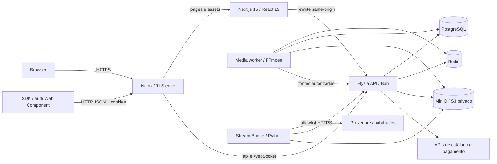

# Arquitetura do ZiPo

Estado documentado em 2026-08-08. Este documento descreve a implementação
observada no repositório; feature flags podem desativar partes do fluxo em cada
ambiente.

## Visão geral

O navegador deve operar em uma origem pública única. O Nginx encaminha
`/api/*` para a API e o restante para o Next.js; o rewrite do Next também usa a
URL interna da API. PostgreSQL é a fonte de verdade, Redis mantém cache, rate
limits, sessões temporárias, presença e filas, e MinIO/S3 guarda mídia privada.

## Módulos e responsabilidades

| Módulo | Responsabilidade | Não deve fazer |
|---|---|---|
| `apps/web` | UI, SSR, internacionalização, player e chamadas same-origin | Receber segredos ou decidir autorização |
| `apps/api` | Auth, autorização, catálogo, perfis, playback, pagamentos e políticas | Executar FFmpeg nas réplicas HTTP |
| `apps/api/src/media/worker.ts` | Consumir filas e produzir clips/HLS | Aceitar URL arbitrária do cliente |
| `services/zipo-stream-bridge` | Preparar mídia de providers explicitamente habilitados | Tornar-se proxy genérico ou aceitar saída de rede livre |
| `packages/shared` | Tipos, schemas e regras isomórficas estáveis | Importar infraestrutura ou estado de runtime |
| `packages/api-client` | SDK TypeScript público, autocontido e baseado em Fetch | Importar contratos privados ou conter credenciais fixas |
| `packages/auth-ui` | Login/registro reutilizável por Custom Element | Persistir senha/token ou aceitar redirect cross-origin |
| `nginx` | Edge, proxy, limites e política de logging | Ser a única camada de autorização |

## Fluxos críticos

### Autenticação e perfis

1. Better Auth recebe as operações em `/api/auth/*`.
2. Sessões usam cookies; mutações autenticadas por cookie passam por CORS e
   verificação de origem CSRF.
3. Rotas de usuário consultam a sessão no servidor e filtram dados pelo
   `user.id`; headers de identidade do cliente não são fonte de autoridade.
4. Perfis de visualização, histórico, playlists e preferências permanecem
   associados ao usuário autenticado.

### Playback

1. A API resolve metadados e providers habilitados.
2. Mídia própria/licenciada usa resolver server-to-server assinado e allowlist
   de origens HTTPS.
3. Sessões temporárias e URLs de recursos são opacas, vinculadas ao proprietário
   e expiram no Redis.
4. Embeds de terceiros são fallbacks por feature flag; os que não suportam
   sandbox têm risco operacional maior e ficam desabilitados por padrão em
   produção.
5. Mídia própria pode usar sessão protegida: token curto, estado sequencial em
   Redis, chave efêmera P-256 e segmentos AES-256-GCM autenticados.

### Mídia assíncrona

1. A API valida usuário, conteúdo, limites e disponibilidade da funcionalidade.
2. Um job persistido é colocado em fila Redis.
3. O worker reivindica o job, resolve uma fonte nativa autorizada, executa
   FFmpeg em diretório temporário e envia o resultado ao bucket privado.
4. O estado final é persistido e slots de concorrência são liberados mesmo em
   erro.

O Stream Bridge mantém seu catálogo de jobs em SQLite com limite de records e
fila ativa. No startup, jobs interrompidos são reconciliados como falhos; os
artefatos finais continuam no storage privado.

### Pagamentos

1. Valor e moeda são definidos pelo servidor.
2. Criação de ordem exige sessão e idempotência.
3. Webhooks são verificados por HMAC, janela temporal e proteção contra replay.
4. Eventos e entitlement são persistidos de forma idempotente.

## Dados e dependências de estado

- PostgreSQL: usuários, sessões, contas, perfis, comentários, clips, salas,
  histórico, feedback, playlists, pagamentos e integrações OAuth.
- Redis: cache, rate limits, leader election, filas de mídia, presença Cinema,
  sessões de playback e estados OAuth de curta duração.
- MinIO/S3: clips, HLS preparado e anexos de mídia; o bucket deve permanecer
  privado.
- Serviços externos: TMDB, Jikan, AniList, Kitsu, Cinemeta, TVmaze, providers de
  playback habilitados e Mercado Pago.

## Disponibilidade e escala

- `/health/live` mede apenas o processo; `/health/ready` exige PostgreSQL e
  Redis; `/health` inclui providers como telemetria.
- Jobs periódicos usam eleição de líder no Redis para evitar duplicação entre
  réplicas da API.
- FFmpeg roda em workers separados. Fila e banco mantêm estado suficiente para
  recuperação de jobs abandonados.
- O Stream Bridge usa executor limitado e SQLite; escalar múltiplas réplicas
  requer migrar esse estado para uma fila/banco compartilhado.
- Cache é tolerante a falha, mas sessão, rate limiting distribuído, Cinema e
  filas dependem de Redis; sua indisponibilidade não é uma simples perda de
  performance.

## Limites arquiteturais de segurança

- Código JavaScript entregue ao navegador é público por definição. Minificação
  e ausência de source maps não protegem segredos nem substituem autorização no
  servidor. A CI rejeita fontes e valores de secrets em artefatos do browser.
- Segmentos protegidos usam TLS e AES-GCM entre edge e player, mas o browser
  precisa obter plaintext para reproduzir. Isso não equivale a DRM nem protege
  contra um usuário final que controla seu dispositivo.
- Validação de SSRF na aplicação deve ser combinada com política de egress no
  ambiente de produção para eliminar janelas de DNS rebinding e limitar impacto
  de uma eventual falha de aplicação.
- O `docker-compose.prod.yml` termina TLS 1.2/1.3 no Nginx, publica 80 apenas para
  redirect e exige certificados montados. Redes não confiáveis entre hosts
  exigem proteção adicional para o tráfego interno.

## Dívida arquitetural conhecida

- `apps/api/src/app.ts` é um harness legado em memória usado por parte dos
  testes; ele não representa todas as rotas e dependências de produção.
- A interseção completa de tipos das rotas Elysia excede o limite de instanciação
  do TypeScript e hoje é reduzida para `Elysia` no tipo público da API.
- Redis combina cache, rate limits, filas e sessões na mesma instância; produção
  maior deve separar workloads e políticas de eviction.
- Dependências Python diretas estão fixadas, mas o ambiente ainda não possui lock
  transitivo com hashes; a CI executa `pip check` e Dependabot até esse artefato
  ser adotado.
- MFA, verificação de e-mail e recuperação dependem de um provider transacional
  e permanecem fora do compose padrão.
